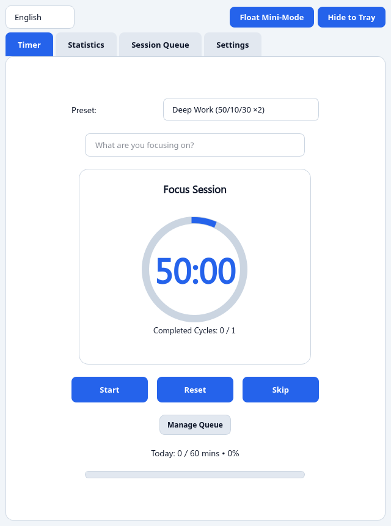
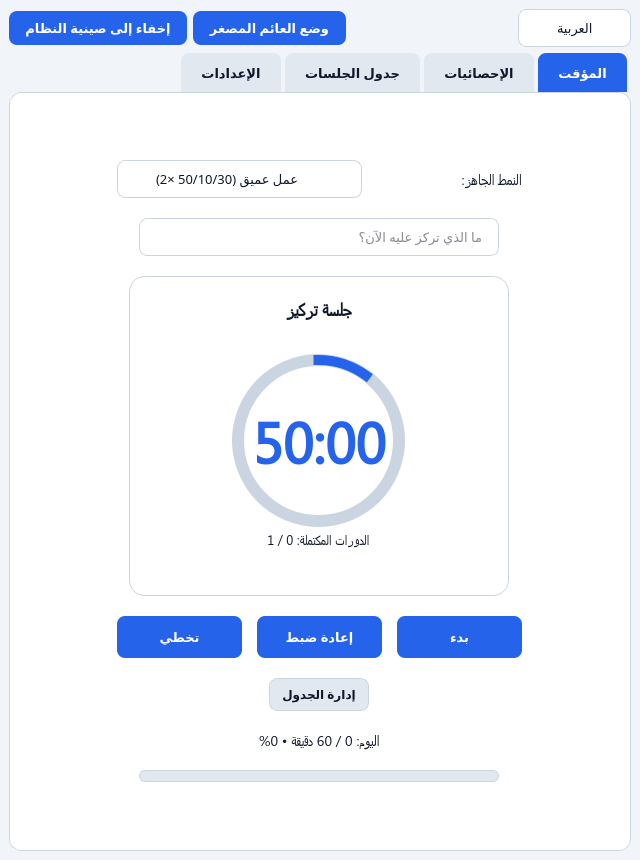
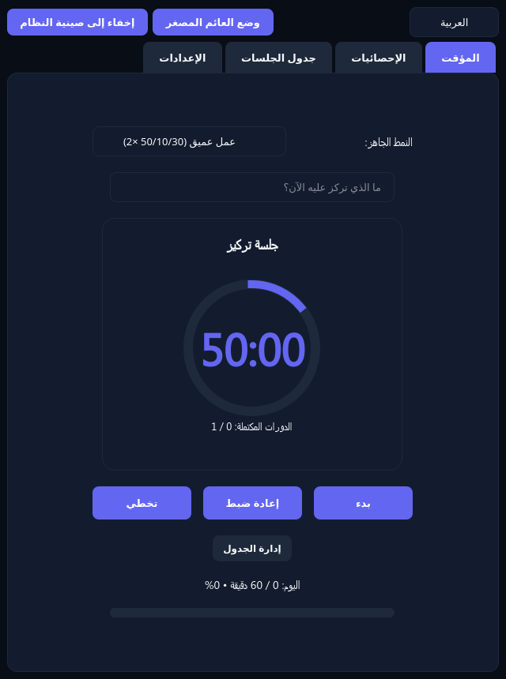
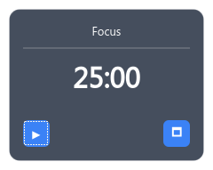

# PomoTime - Professional Pomodoro Timer

[](https://www.python.org/)
[](https://www.pyqt.org/)
[](https://opensource.org/licenses/MIT)
[]

---

## 🎯 A Professional, Native Pomodoro Timer for Focus Management

**PomoTime** is a polished, commercial-grade desktop application built with Python 3 and PyQt6 that helps you manage focus sessions using the proven Pomodoro technique. Combining a clean modern UI with full bilingual support (English/Arabic), Right-to-Left (RTL) layout, floating mini-mode, customizable themes, and a powerful multi-block Session Queue — all without requiring any external multimedia dependencies.

Designed for privacy and performance, PomoTime relies entirely on native system tools and pure Python audio synthesis, making it lightweight, portable, and respectful of your system resources.

**PomoTime is currently built and supported for Linux only** (`.AppImage`, `.deb`, and source compilation with Python 3.10+ & PyQt6). Windows and macOS support is planned for future releases.

---

## 📸 Screenshots

| English (Clean Default) | Arabic (RTL) | Dark Theme (Midnight) | Mini-Mode |
|:------------------------:|:------------:|:---------------------:|:--------:|
|  |  |  |  |

---

## ✨ Key Features

### 🎯 Focus & Break Timers
- **Focus Session**: Default 25 minutes (fully customizable)
- **Short Break**: Default 5 minutes
- **Long Break**: Default 20 minutes (after configurable cycles)
- Automatic long break scheduling after reaching cycle target

### 📚 Multi-Block Session Queue
- **Custom Session Planner**: Build your own sequence of focus blocks and breaks
- **Block Editor**: Choose stage type, duration (1–180 min), and optional task labels
- **Quick-Add Patterns**: `+ 2 Focus + Long Break`, `+ 1 Extra Cycle`
- **Reordering**: Move Up, Move Down, Delete Block, Clear Queue
- **Automatic Progression**: Timer advances through every step in order
- **Live Progress**: `Queue Step 2 of 7 • Next: Long Break (15m)` displayed under timer

### 🎛️ Productivity Presets
- **Classic Pomodoro**: 25m focus / 5m break / 20m long break × 4
- **Deep Work**: 50m focus / 10m break / 30m long break × 2
- **Quick Sprint**: 15m focus / 3m break / 10m long break × 4
- **Custom Queue**: Activate your own multi-block sequence

### 🌙 Daily Focus Goal
- Set a daily target in minutes
- **Themed progress bar**: `Today: 50 / 120 mins • 42%` on Timer & Statistics tabs
- **Midnight reset**: Daily counter resets at 00:00 while all-time totals and history are preserved

### 📊 Statistics & CSV Export
- **Recent Sessions Log**: Scrollable list with task name, duration, and timestamp
- **Export to CSV**: Full session history (task, duration, completion time) via `QFileDialog`
- **Productivity Score**: 0–100 calculation based on completed cycles and focus time
- **All-Time Totals**: Total focus minutes, completed cycles, breaks taken

### 🎨 Visual Themes
- **Clean Default**: Professional light theme
- **Calm Forest**: Soothing green theme
- **Midnight Focus**: Dark theme for night owls
- **Warm Sunset**: Amber/orange theme for warm preferences

### 🌐 Bilingual & RTL Support
- **Instant Language Switch**: English (LTR) ↔ Arabic (RTL)
- **Full Interface Translation**: All labels, buttons, dialogs, presets, queue items
- **RTL Layout**: `QComboBox`, `QSpinBox`, `QTabWidget` all align correctly in Arabic
- **Arabic Typos Fixed**: Native-quality Arabic translations throughout

### 📢 Notification Chimes (Zero External Assets)
- **Soft, synthesized bell tones**: Generated purely in Python (`math`, `wave`, `struct`)
- **4 distinct sounds**: `click`, `start_focus`, `start_break`, `alert`
- **Native playback**: `paplay`/`aplay` on Linux (terminal bell as final fallback)
- **No QtMultimedia dependency**: Pure Python audio generation only

### 📌 System Tray & Mini-Mode
- **Hide to Tray**: Completely hide the main window while timer continues running
- **Floating Mini-Mode**: Always-on-top widget showing remaining time, stage, and active task
- **Boundary Detection**: Prevents widget from being dragged off-screen
- **Keyboard Shortcuts**: `Space` (Start/Pause), `R` (Reset), `S` (Skip), `M` (Mini-Mode)

### ⌨️ Keyboard Shortcuts
| Key | Action |
|-----|--------|
| `Space` | Start/Pause timer |
| `R` | Reset current session |
| `S` | Skip current stage/queue block |
| `M` | Toggle Floating Mini-Mode |

---

## 🚀 Quick Start & Installation

### Prerequisites
```bash
# Clone the repository
git clone https://github.com/your-username/PomoTime.git
cd PomoTime

# Install dependencies
pip install PyQt6>=6.5.0
```

### Running the Application
```bash
python3 pomotime.py
```

### Building & Distribution
- **AppImage**: Download the pre-built `.AppImage` from [GitHub Releases](https://github.com/Mo-FouadX/PomoTime/releases/latest), or build with `linuxdeploy` + `appimagetool`.
- **.deb Package**: Download the pre-built `.deb` from [GitHub Releases](https://github.com/Mo-FouadX/PomoTime/releases/latest), or build with `dpkg-deb` from the CI pipeline.
- **Source Compilation**: `pip install -r requirements.txt && python3 pomotime.py`
- **GitHub Releases**: Pre-built Linux installers available from the Releases page.

### Requirements
- Python 3.10+
- PyQt6 >= 6.5.0
- No multimedia packages required (pure Python audio, native system players only)

---

## 📋 Keyboard Shortcuts

| Shortcut | Action |
|----------|--------|
| `Space` | Start/Pause the timer |
| `R` | Reset the current session or restart a completed queue |
| `S` | Skip the current stage or queue block |
| `M` | Toggle Floating Mini-Mode (always-on-top widget) |

---

## 🛠️ Development & Methodology

**PomoTime was crafted using Vibe Coding (AI-Assisted Development)** with human product direction, UX iteration, and Linux desktop testing. The application was designed from the ground up as a professional productivity tool, with careful attention to:

- **Clean code structure** maintainable by human developers
- **Accessible design** with full bilingual and RTL support
- **Native performance** without external asset dependencies
- **Linux-first architecture**: Optimized for Linux desktop environments (X11/GTK/Qt)
- **Privacy-respecting architecture**: No external APIs, no telemetry, no background sound servers

The project demonstrates how AI-assisted development can produce production-quality software when guided by experienced product direction and thorough testing on the target platform.

---

## 📦 File Structure

```
PomoTime/
├── pomotime.py          # Main application logic, UI, presets, session queue
├── requirements.txt     # PyQt6>=6.5.0
├── CONTEXT.md          # Technical reference documentation
├── PLAYAPP.md          # User guide
├── README.md           # This file
├── assets/
│   └── screenshots/    # Application screenshots
└── .github/
    └── workflows/
        └── build.yml   # CI/CD pipeline
```

---

## 💡 Tips & Best Practices

- **Use Presets**: Start with Classic Pomodoro, Deep Work, or Quick Sprint, then customize
- **Build Custom Queues**: For complex work sessions, use the Session Queue tab to plan multi-block patterns
- **Set Daily Goals**: Track progress toward realistic daily focus targets
- **Switch Languages**: Use the language selector to toggle between English and Arabic
- **Try Different Themes**: Find the visual style that works best for your environment
- **Use Mini-Mode**: Keep focus time visible while working in other applications
- **Export History**: Regularly export your session CSV for personal analytics or productivity tracking

---

## 📄 License

**PomoTime** is released under the MIT License. See the accompanying LICENSE file for details.

---

<div align="center">

**Built with Python 3 & PyQt6 • Powered by native system tools • No external multimedia dependencies**

</div>